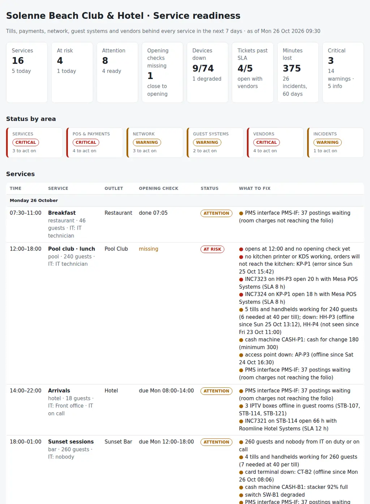

# Venue Service Readiness

The morning check of a hospitality venue before its services: a restaurant, a pool club, a bar, a hotel and the events in between. For every service in the next week it puts together:

- **The service:** the opening check before doors open, someone from IT on duty for the big ones, and no update scheduled the night before.
- **The outlet's kit:** enough working tills and handhelds for the guests expected, the kitchen printers or KDS, the card terminals, the cash machine's float and stacker.
- **What it runs on:** the internet lines and the failover, the Wi-Fi access points, switches and firewall, the PMS interface for room charges, IPTV and key card encoders for the hotel.
- **Who fixes it:** the vendor of each device, its support hours against the service hours, its SLA against the open tickets, and its contract.

Four CSVs, one JSON with the rules and one Python command give each service a verdict (**ready**, **attention** or **at risk**) and produce the opening pack for the team: **what could fail in which service, and who fixes it before the doors open.**

Python 3.10+, standard library only. It runs with fictional demo data out of the box. A read-only PowerShell probe that checks every device on the venue network and writes the device file is included.



## Why

When the pool club fills up at one o'clock, nobody remembers that the monitoring was green at nine. They remember the orders that never reached the kitchen, the queue at the only card terminal that worked, or the room charges that never reached the guest's bill. Each of those was visible that morning:

- the beach kitchen printer had been in error since the afternoon before, with a ticket open with the POS vendor for 18 hours;
- two of the four handhelds were dead or in a drawer, for 240 guests;
- the backup internet line had been down for five days, so the next fibre cut would stop every card payment;
- the PMS interface had 37 room charges waiting;
- and the POS vendor answers until seven in the evening, while the bar closes at one.

The signals live in the POS back office, the network controller, the cash machine and PMS consoles, the vendors' portals and the service plan. The check that matters joins them per service, because the same handheld down is a note for a quiet breakfast and a decision for a 900-guest party. The rules are in `settings.json` and `venueready/checks.py`.

For opening a venue from scratch (the IT critical path from T-90 to go-live), see [24-hospitality-it-preopening](https://github.com/inigogonzalezgarcia/24-hospitality-it-preopening); this tool is for every day after the opening.

## What it checks

| Area | Code | Finding |
|---|---|---|
| Services | SVC-01 | No opening check within `check_window_hours`; critical within `check_lead_hours` of opening |
| Services | SVC-02 | Services with `duty_min_guests` or more, and every event, with nobody from IT on duty or on call |
| Services | SVC-03 | Device update scheduled inside the `freeze_hours` before the service |
| POS & payments | POS-01 | Fewer working tills and handhelds than `guests_per_till` needs; critical when none works |
| POS & payments | POS-02 | Kitchen printer or KDS down in a service with food (critical when none works), receipt printer down |
| POS & payments | POS-03 | Devices behind the target software version (for information) |
| POS & payments | PAY-01 | Card terminals down (critical when none works) or none registered |
| POS & payments | PAY-02 | Cash machine in error (critical), float below `cash_float_min` or stacker above `cash_full_pct` |
| Network | NET-01 | Primary internet line down (running on backup); critical when no line works |
| Network | NET-02 | Wi-Fi access points down in the outlet; critical when none works |
| Network | NET-03 | Switch or firewall down (critical) or degraded |
| Network | NET-04 | Backup internet line down: no failover |
| Guest systems | GST-01 | PMS interface down (critical) or more than `pms_queue_max` postings waiting |
| Guest systems | GST-02 | IPTV headend down (critical) or more than `stb_offline_max` room boxes offline |
| Guest systems | GST-03 | No key card encoder working |
| Vendors | VND-01 | Open tickets past the vendor's SLA; critical when the device is down today |
| Vendors | VND-02 | Support contract ended, or ending within `contract_warn_days` (for information) |
| Vendors | VND-03 | Services opening or closing outside the vendor's support hours (for information) |
| Vendors | VND-04 | Open tickets still inside the SLA (for information) |
| Incidents | INC-01 | Device with `repeat_incidents` or more incidents in `incident_window_days` |
| Incidents | INC-02 | Incidents and service minutes lost by category (for information) |

## Outputs

| File | What |
|---|---|
| `report.html` | Tiles, status by area, the services day by day with their verdict and what to fix, "Fix first", devices by outlet, devices with something to do and their tickets, vendors, incidents by outlet, all findings |
| `opening-pack.md` | Summary, decisions with owners, and a checklist per service: opening check, devices working, each issue |
| `service-readiness.csv` | Every service with its outlet, guests, IT on duty, opening check, verdict and issues |
| `device-health.csv` | Every device: outlet, type, status, last seen, version, next update, vendor and notes |
| `vendor-cover.csv` | Every vendor: what it covers, hours, SLA, contract, open tickets, past SLA and the services outside its hours |
| `incidents-by-outlet.csv` | Incidents, open tickets and service minutes lost per outlet, with categories and devices |
| `actions.csv`, `findings.csv` | The findings with owner and next step, ready for a tracker |

## Try it

```bash
git clone https://github.com/inigogonzalezgarcia/34-venue-service-readiness.git
cd 34-venue-service-readiness
python -m venueready demo
```

Open `output/report.html` and `output/opening-pack.md`.

### The demo data

The demo is a made-up beach club and boutique hotel, Solenne Beach Club & Hotel, with a restaurant, a pool club, a sunset bar and 24 rooms:

- 16 services from Monday 26 October to Sunday 1 November 2026, including a 900-guest Halloween night;
- 74 devices: cloud POS tills and handhelds, kitchen printers and a KDS, card terminals, cash recyclers, Wi-Fi, switches, firewall, two internet lines, the PMS interface, the IPTV headend, 24 room boxes and key encoders;
- five vendors and 60 days of tickets, reviewed on Monday at 09:30.

All names are fictional. The problems are placed on purpose:

- **Pool club, today:**
  - no opening check two and a half hours before lunch;
  - the only kitchen printer in error since yesterday, with its ticket past the vendor's SLA;
  - two handhelds down for 240 guests;
  - an access point by the sun loungers offline;
  - the cash machine short of change.
- **Sunset bar, tonight:**
  - 260 guests and nobody from IT on call;
  - a card terminal that failed four times in two months is down again;
  - the PoE switch is degraded and the cash machine's stacker is 92% full.
- **Hotel arrivals:** three rooms without TV, a ticket open for almost three days, and 37 room charges waiting in the PMS interface.
- **The venue:**
  - the backup internet line has been down for five days;
  - the network provider's contract ended almost a month ago;
  - the POS vendor's hours do not cover a single dinner.
- **The week ahead:**
  - a POS update the night before Friday's dinner;
  - a firewall update hours before the Halloween night;
  - 900 guests with five working tills and handhelds and no IT on duty.

## Use it with your own venue

1. Probe the devices from a machine on the venue network (read-only), starting from an inventory with the IP and, if you want, the port of each device:
   ```powershell
   .\scripts\Test-VenueDevices.ps1 -Inventory .\data\inventory.csv -OutputFile .\data\devices.csv
   ```
   - The script only pings and opens a TCP connection; it stores no credentials and changes nothing.
   - It keeps the last time each device answered between runs.
   - Add what only the consoles show: cash machine levels, the PMS interface queue, error states and scheduled updates.
2. Write `services.csv` with the week's services, expected guests and who from IT is on duty, and `vendors.csv` with your vendors, their hours, SLA and contract end.
3. Export `incidents.csv` from the service desk or the vendors' portals and adjust `data/settings.json` ([docs/data-format.md](docs/data-format.md)).
4. Build the outputs:
   ```bash
   python -m venueready review data/ --title "Service readiness · Monday"
   ```

[docs/opening-runbook.md](docs/opening-runbook.md) has the 15-minute morning check, how to read each signal and the opening check for each outlet.

The exports contain device addresses, vendor details and the venue's plans. Keep them inside your organisation:

- real files at the top level (`services*.csv`, `devices*.csv`, `vendors*.csv`, `incidents*.csv`, `settings.json`, `data/`) and the `output/` folder are excluded from Git by `.gitignore`;
- only the fictional files in `sample_data/` are committed.

## Tests

```bash
pip install -r requirements-dev.txt
python -m pytest -q
```

GitHub Actions runs them on Python 3.10 and 3.12 on every push, then rebuilds the fictional sample data and the report screenshot from the simulator.

15 tests: services, devices and vendors exported with other column names, Spanish names, accents and semicolons; support hours, including windows past midnight; settings; the opening check rules; IT cover and the update freeze; tills, kitchen printers and card terminals; cash machines; internet lines, Wi-Fi and switches; the PMS interface, IPTV and key encoders; vendor SLA, contracts and hours; repeated incidents and versions; and the demo end to end (deterministic, all eight outputs).

## Next steps

- Read the device states straight from the POS back office and the network controller APIs, instead of a probe and a CSV.
- Sales per till and per hour from the POS, to size the tills each service needs from real data rather than guests per till.
- A short message to each outlet manager before opening with their service's checklist.
- Minutes lost per service written back after closing, to close the loop with INC-01 and the vendors' monthly reviews.

## Background

Built from my work in IT for hospitality and retail:

- supporting POS systems (ICG, HIOPOS, CashDro cash machines), hotel PMS and IPTV for hospitality clients;
- around 200 pre-openings of luxury brand corners in department stores, including one where the connection failed two hours before opening;
- managing connectivity, hardware and service vendors, their SLAs and contracts.

Written from scratch with fictional data; no employer data, systems or exports are used.

## Customisation and contact

Want this adapted to your venue? For example:

- your outlets, services and the opening check each one needs;
- your POS, cash machines, PMS and network controller exports;
- your vendors, their hours and SLAs;
- the opening pack sent to the outlet managers every morning.

Get in touch:

- Website (contact form): [inigogonzalezgarcia.github.io](https://inigogonzalezgarcia.github.io/about.html#contacto)
- LinkedIn: [linkedin.com/in/igonzalez93](https://www.linkedin.com/in/igonzalez93)

## License

MIT
